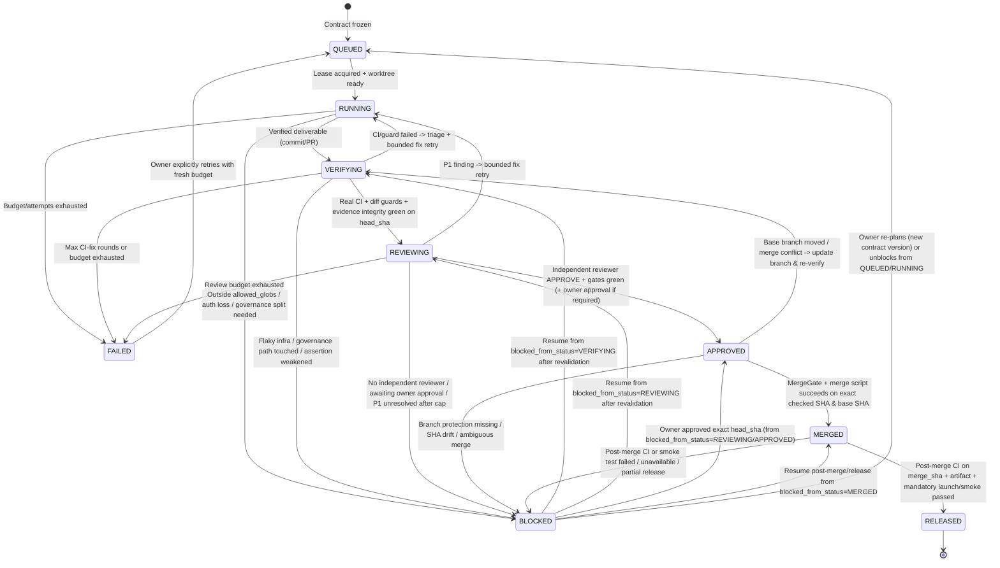

# Night-Shift Desktop: Role-Based Agent Pipeline (AI Assembly Line)

**Status:** Design specification (Phase 8a — docs only)
**Governance baseline:** Incorporates the GPT Governance Amendment (2026-11-27, accepted by Claude and the owner). Where any earlier pipeline idea conflicts with the amendment, the amendment governs.
**Related docs:** [BLUEPRINT.md](BLUEPRINT.md) (sections 5–5j), [DESIGN_SYSTEM.md](DESIGN_SYSTEM.md), [AGENTS.md](../AGENTS.md).

---

## 1. Purpose, principles, and mandatory build order

Night-Shift Desktop turns unattended overnight software delivery into a **role-based AI assembly line**:

1. **Plain code does every mechanical step.** Builds, tests, UI screenshot capture, artifact checksums, evidence collection, PR body templating from real data, git worktree management, diff-guard checks, and merge/release execution are deterministic Python scripts (free, repeatable, zero AI hallucination).
2. **AI does only work that requires judgment.** Planning, writing code, summarising failing logs (triage), and independent code review.
3. **Trust boundaries come before cost optimisation.** A cheaper model is only valuable if it cannot weaken tests, bypass gates, fabricate evidence, or approve its own code.
4. **Cheapest reliable model per risk class, proven by measurement.** Free-only defaults apply until the owner opts in to paid tiers; cheaper models are promoted for a task class only after passing benchmark thresholds on that class. Owner overrides per phase/task win **within** hard safety and governance boundaries.
5. **Replayable and durable.** Every step's input, output, contract hash, router decision, and evidence record is saved to SQLite (WAL) and redacted log files. Killing the app, sleeping the PC, or losing internet never causes duplicate PRs, duplicate merges, or duplicate releases.

### Mandatory build order (Governance Amendment)

Implementation **must** follow this sequence. Later phases may not start until earlier phases reach at least `Integration-tested` maturity.

**Staged rollout safety rule (no bypass during partial deployment):** Phase 8b introduces a single mandatory merge-gate chokepoint (`MergeGate.authorize_merge(task, head_sha)`) wired into `EngineStateMachine` (`backend/nightshift/engine/state_machine.py`). Until Phases 8b–8e all reach `Integration-tested` maturity, **autonomous merging for pipeline tasks is disabled by default** (tasks stop at `BLOCKED` / `awaiting_owner_approval` instead of calling the legacy auto-merge path).

| Build Phase | Scope | Exit Gate | Target Maturity |
|---|---|---|---|
| **Phase 8a** (this doc) | Design specification + cross-provider review | Design signed off, CI green | Design approved |
| **Phase 8b** | **1. Trust boundaries + protected test authority** (Amendment A, B, E) | Frozen requirement contracts (append-only, hash-verified), `allowed_globs` & rename-aware governance protection, blocking assertion-relaxation detector, scrubbed runner env, single `MergeGate` chokepoint (auto-merge off until 8e) | `Integration-tested` |
| **Phase 8c** | **2. Durable task orchestration** (Amendment D) | Task-level state machine (`QUEUED`..`RELEASED`) with `blocked_from_status` resume, `remote_operations` outbox, atomic lease/fencing, crash/network resume tests with zero duplicate PRs/merges/releases | `Integration-tested` |
| **Phase 8d** | **3. Trustworthy verification & evidence integrity** (Amendment F) | Exact-SHA & post-merge `merge_sha` check verification, real job duration & artifact presence enforcement, verified-build screenshot manifest, PR-body-is-not-evidence rule | `Integration-tested` |
| **Phase 8e** | **4. Risk-based review & release governance** (Amendment C, G, H) | Risk classifier, provider-independent reviewer excluding all contributing providers (coders + fixers) with raw diff + contract + validated citations, owner-approval gates, mandatory post-release launch/smoke test + one-click rollback; unlocks conditional auto-merge for eligible classes | `Integration-tested` |
| **Phase 8f** | **5. Cheap triage, economics ledger & model routing** (Amendment I) | Triage role (`small_job_ladder`), cost-per-accepted-change ledger, benchmark graduation gate for Economy promotion, Pipeline Ledger & Scores UI module | `Production-proven` (after real overnight runs) |

### Maturity labels (Amendment J)

Every pipeline stage in documentation and in the UI **must** display one of three maturity labels—never a vague "built" or "done":

| Label | Meaning | Evidence required to claim it |
|---|---|---|
| `Implemented` | Code and unit tests exist on `main`, CI green | Unit tests (`pytest` / `vitest`) passing on real CircleCI |
| `Integration-tested` | End-to-end flow verified with fake/controlled runners, fake `gh`, Playwright `MockBridge`, and crash-resume tests | Integration + E2E suite passing on real CircleCI with artifacts |
| `Production-proven` | Completed >= 5 unattended overnight tasks on a real project without trust-boundary bypass, duplicate side-effects, or unrecovered crashes | Recorded ledger history across >= 5 accepted tasks |

---

## 2. Pipeline stages and roles

Each feature phase from the Planning Council is decomposed into one or more small **tasks** (each mapping to a single PR). Every stage has a single owner role and a strict AI vs. mechanical boundary:

| # | Stage | Executor | Role | Input | Output |
|---|---|---|---|---|---|
| 1 | **PLAN** | AI (Strong model + Planning Council cross-check) | `planner` | Owner goal + compact repo snapshot (`repomix --compress`) | Task list, frozen **Requirement Contract** per task, and machine-checkable acceptance test spec written *before* coding |
| 2 | **CODE** | AI (Risk-routed implementer; eligible owner override wins) | `coder` | Frozen contract + repo worktree + handoff note (if resumed) | Commits on task branch within `allowed_globs` only |
| 3 | **MECHANICAL** | Plain code (no AI) | `mechanical` | Task worktree + frozen contract | Local/CI build, test execution, verified-build UI screenshots, SHA-256 evidence bundle, PR body filled from template with real data |
| 4 | **TRIAGE** | AI (Cheap model from `small_job_ladder`, built in Phase 8f) | `triage` | Failing CI/job log tail | Structured summary (`<= 10 lines`): root cause + `file:line` + suggested fix |
| 5 | **FIX** | AI (Routed by **risk class**, informed by triage summary) | `fixer` | Frozen contract + triage summary + failing diff/guard finding | Targeted fix commit on task branch |
| 6 | **REVIEW** | AI (Different **provider** than *every* contributing coder/fixer) | `reviewer` | **Raw git diff + frozen contract only** (never coder's PR description) | Structured P1/P2 findings with validated `file:line` or omission citations, verdict (`APPROVE` / `CHANGES`) |
| 7 | **GATES** | Plain code (no AI) | `gatekeeper` | Exact head SHA + CircleCI API + diff guards + UI contract + contract digest | Pass/fail gate record (`evidence_records` + `guard_results`) |
| 8 | **MERGE / RELEASE** | Plain code (no AI) | `releaser` | Approved task + green gates on exact SHA (+ owner approval if required) | Merge commit, post-merge CI verification on `merge_sha`, verified release artifact, mandatory post-release launch/smoke test, rollback pointer |
| 9 | **LEDGER + SCORES** | Plain code (no AI) | `accountant` | All attempts, tokens, CI minutes, storage, review & regression outcomes | `pipeline_ledger` rows, `model_scores` (cost per accepted change, acceptance rate, regression rate) |

### Provider-independence matrix (Amendment G)

Independence is enforced at the **provider** level, not merely the CLI name (`agy` and `gemini` are both Google and are **not** independent of each other). Crucially, the engine records `contributing_providers` — the set of **every** provider that authored or modified commits on the task branch across `CODE`, `FIX`, and mid-task handoffs — and excludes the entire set from `REVIEW`:

| Provider | Engines / CLIs | May review work only when NOT in `contributing_providers` |
|---|---|---|
| `google` | `agy` (Antigravity neon/hydrogen), `gemini` (Gemini CLI) | Excluded if either `agy` or `gemini` wrote any code or fix commit on the branch |
| `openai` | `codex` (GPT / Codex CLI) | Excluded if `codex` wrote any code or fix commit on the branch |
| `anthropic` | `claude` (Claude Code) | Excluded if `claude` wrote any code or fix commit on the branch |
| `alibaba` | `qwen` (Qwen Code) | Non-high-risk classes only, after benchmark graduation, and not in `contributing_providers` |
| `deepseek` / `moonshot` / `zhipu` / `minimax` | Claude-compatible endpoints (`deepseek`, `kimi`, `glm`, `minimax`) | Non-high-risk classes only, after benchmark graduation, and not in `contributing_providers` |

**Hard rule:** If no engine from a provider outside `contributing_providers` is available for a task requiring independent review, the task transitions to `BLOCKED` (`no_independent_reviewer`). A provider **never** approves its own code or its own fix.

---

## 3. Trust boundaries, requirement contracts, and protected test authority

### 3.1 Frozen requirement contract (Amendment B)

Before Stage 2 (`CODE`) begins, the engine materialises an append-only `task_contracts` row in SQLite. The canonical JSON payload **excludes** the digest itself; `contract_sha256` is computed as `SHA-256(UTF-8(canonical_json))` (RFC 8785 / sorted keys, compact separators) and stored alongside it.

```json
{
  "task_id": "p8b-t01",
  "version": 1,
  "phase_id": "p8b",
  "title": "Enforce allowed_globs in diff guards",
  "risk_class": "business_logic",
  "risk_factors": {
    "impact": 3,
    "data_sensitivity": 1,
    "reversibility": 2,
    "test_coverage": 4,
    "uncertainty": 2
  },
  "acceptance_criteria": [
    {
      "id": "ac-1",
      "description": "Diff touching file outside allowed_globs returns GuardFinding(guard='outside_allowed_globs')",
      "check_command": "pytest -q backend/tests/test_verify.py -k test_allowed_globs"
    }
  ],
  "allowed_globs": [
    "backend/nightshift/engine/verify.py",
    "backend/nightshift/engine/state_machine.py"
  ],
  "forbidden_globs": [
    ".circleci/**",
    ".github/**",
    "scripts/check_*",
    "design/tokens.json",
    "docs/DESIGN_SYSTEM.md"
  ],
  "budget": {
    "max_tokens": 120000,
    "max_usd_est": 0.50,
    "max_attempts": 4,
    "max_ci_fix_rounds": 4,
    "max_wall_minutes": 90
  },
  "owner_approval_required": false,
  "frozen_at": "2026-11-27T18:00:00Z"
}
```

**Immutability and enforcement:**
- SQLite `BEFORE UPDATE` and `BEFORE DELETE` triggers on `task_contracts` reject any mutation of a frozen contract row.
- Every gate (`VERIFYING`, `REVIEWING`, `APPROVED`, `MERGE`) recomputes `SHA-256(canonical_json)` and verifies it matches `tasks.contract_sha256` and `task_contracts.contract_sha256`.
- **Re-planning / contract revision:** If a coder genuinely needs an additional file, the task moves to `BLOCKED` (`contract_revision_needed`). Only the owner or a Planning Council re-plan may insert `version + 1` into `task_contracts` and update `tasks.contract_id` / `tasks.contract_sha256`; doing so **automatically invalidates** all prior `evidence_records`, `review_sha`, and `owner_approved_sha` for that task.
- **Path extraction (rename/delete/case safe):** Diff inspection uses `git diff --name-status -M -C <base>..HEAD` (never plain `--name-only`) and evaluates **both** old and new paths for renames (`R`), copies (`C`), and deletions (`D`), normalized to POSIX `/` and case-folded on case-insensitive filesystems (Windows) before matching `allowed_globs`, `forbidden_globs`, and governance rules. Any path outside `allowed_globs` (or matching `forbidden_globs`) triggers `GuardFinding(guard="outside_allowed_globs")` and **blocks merge**.

### 3.2 Protected test authority (Amendment A)

The coding agent must never control how its own work is judged.

**Governance-classified paths** (normalized POSIX, case-folded on Windows, plus project-configured `protected_paths`):
- **Tests & test harnesses:** `**/tests/**`, `**/__tests__/**`, `**/*_test.py`, `**/test_*.py`, `**/conftest.py`, `**/*.test.ts`, `**/*.test.tsx`, `**/*.spec.ts`, `**/*.spec.tsx`, `**/*.test.js`, `**/*.test.jsx`, `**/*.spec.js`, `**/*.spec.jsx`, `pytest.ini`, `vitest.config.*`, `jest.config.*`, `playwright.config.*`, and `[tool.pytest*]` edits in `pyproject.toml`
- **CI & packaging definitions:** `.circleci/**`, `.github/workflows/**`, `backend/packaging/**`
- **Gate scripts:** `scripts/check_*.py`, `scripts/**`
- **Design-contract files:** `design/tokens.json`, `docs/DESIGN_SYSTEM.md`, `frontend/src/design/tokens.ts`, `frontend/src/design/tokens.css`, project `ui_contract`
- **Branch rules / agent rules / acceptance contracts:** `AGENTS.md`, `GEMINI.md`, `.nightshift/contracts/**`

**Rules:**
1. **Automatic classification:** Any PR whose diff (including old or new paths of renames/deletions) touches any protected path is automatically classified `risk_class = governance`, regardless of what the planner originally labelled it.
2. **Separate PR mandatory:** A PR may not mix `governance` paths with feature implementation paths. If a feature needs new acceptance tests, those tests are opened in a **separate Governance PR** (reviewed and approved by the owner, merged first) before the feature PR runs against them.
3. **No auto-merge:** `governance` PRs always transition to `BLOCKED` (`awaiting_owner_approval`) after green CI + independent review. `MergeGate` refuses to merge any `governance` PR without an explicit recorded owner approval (`owner_approved_sha == head_sha`).
4. **Deleted or relaxed assertion detection (blocks merge unconditionally):** Plain-code static analysis (`verify.py`) inspects every diff touching test files and **blocks merge** on any finding—for both feature PRs and governance PRs:
   - Python tests (AST diff): net decrease in `assert` statements, `pytest.raises`, or `assert_*` calls in an existing test function; deleted test functions/files; new `@pytest.mark.skip`, `@pytest.mark.xfail`, or broadened `except Exception: pass`.
   - TypeScript/JavaScript/Vitest/Playwright tests (AST/regex diff): net decrease in `expect(...)` calls; replacement of strict matchers (`toBe`, `toEqual`, `toHaveText`) with vacuous matchers (`toBeDefined`, `toBeTruthy`); new `.skip`, `.only`, or `test.fixme`; removal of `axe` accessibility checks.
   - **Authorized remediation for legitimate test refactors:** Only inside a dedicated `governance` PR, the owner may explicitly record a signed `assertion_waiver` tied to the exact `head_sha` and written rationale; without that waiver, the merge gate stays blocked.

---

## 4. Durable state machine per task (Amendment D)

Night-Shift's existing `phases` table tracks coarse phase status. The agent pipeline introduces a fine-grained, crash-safe **task state machine** where every transition executes in a single SQLite `BEGIN IMMEDIATE` transaction that updates `tasks` and appends to `task_transitions`.



### State definitions and persistence guarantees

| State | Meaning | Persisted fields updated atomically on `tasks` |
|---|---|---|
| `QUEUED` | Contract frozen, dependencies met, waiting for worker slot | `status`, `contract_id`, `contract_sha256`, `updated_at` |
| `RUNNING` | AI coder or fixer active in isolated worktree (or checkpointing handoff) | `status`, `active_attempt_id`, `worker_pid`, `lease_token`, `lease_expires_at`, `branch` |
| `VERIFYING` | Mechanical scripts running build, tests, screenshots, diff guards, CircleCI watch | `status`, `head_sha`, `pr_number`, `ci_run_id` |
| `REVIEWING` | Independent cross-provider reviewer inspecting raw diff + contract on `head_sha` | `status`, `review_sha` |
| `APPROVED` | All required gates green on exact `head_sha` + reviewer approved (+ owner approved if required) | `status`, `approved_sha`, `owner_approved_by`, `owner_approved_sha`, `owner_approved_at` |
| `MERGED` | Merge script merged `approved_sha` into `main`, awaiting post-merge `merge_sha` CI & release | `status`, `merge_sha`, `merged_at` |
| `RELEASED` | Post-merge CI green on `merge_sha`, release artifact published with `SHA256SUMS`, mandatory launch/smoke test passed, rollback pointer saved | `status`, `release_tag`, `smoke_verified_at` |
| `BLOCKED` | Needs owner action or external precondition (never burns retries or budget while blocked) | `status`, `blocked_from_status`, `block_reason`, `block_detail`, `next_step` |
| `FAILED` | Bounded retries or hard budget exhausted; terminal until owner explicitly resets | `status`, `failure_reason`, `finished_at` |

### Resume from `BLOCKED` (no accidental coding restart)

When a task enters `BLOCKED`, `blocked_from_status` persists the exact state it came from. When the owner resolves the blocker (e.g., approves a governance PR, fixes login health, or repairs a release smoke check), the engine resumes at `blocked_from_status` (or `APPROVED` when owner approval completes `REVIEWING`) **only after** revalidating:
1. `contract_sha256` matches the frozen contract,
2. `head_sha` (or `merge_sha`) has not drifted,
3. all required `evidence_records` are still valid for that exact SHA, and
4. `owner_approved_sha == head_sha` if owner approval is required.

Only an explicit contract revision (`version + 1`) or owner-requested restart returns a task to `QUEUED`.

### Durable side-effect reconciliation, fencing, and crash/offline recovery

Every external mutation (`pr_create`, `pr_merge`, `release_create`, `release_asset_upload`, `revert_pr_create`) uses a durable outbox table (`remote_operations`) with an atomic **lease/fencing token** (`lease_token`, UUID rotated per worker acquisition):

1. **Write-ahead intent:** Before calling `git push` or `gh`, insert a `remote_operations` row (`status = 'pending'`, unique `idempotency_key`, current `lease_token`). If another worker's lease is active, the transaction aborts.
2. **PR reconciliation (open, closed, and merged):** Before `gh pr create`, query `gh pr list --head <branch> --state all`:
   - Open PR exists -> adopt `pr_number`, mark operation `succeeded`, advance to `VERIFYING`.
   - Merged PR exists -> adopt `merge_sha`, advance to `MERGED`.
   - Closed (unmerged) PR exists -> do **not** silently create a duplicate; mark `BLOCKED (closed_pr_exists)` for owner decision.
3. **Merge reconciliation & race-safe base check:** Before merging `approved_sha`, verify `origin/main` equals the `expected_base_sha` tested by CI (or branch is fast-forward/up-to-date with `main`), then merge with `--match-head-commit <approved_sha>`. On crash/timeout during merge, query PR state (`MERGED` vs `OPEN`): if merged, adopt `merge_sha`; if ambiguous (API error/unknown), mark `remote_operations.status = 'ambiguous'` and fail closed to `BLOCKED (ambiguous_remote_operation)` until reconciled.
4. **Partial release reconciliation:** Release creation and asset upload are tracked as distinct `remote_operations` keyed by `merge_sha` (embedded as `<!-- nightshift-merge-sha: <sha> -->` in release notes). On restart:
   - If a release already exists for `merge_sha` with all expected assets + `SHA256SUMS.txt` matching local checksums -> adopt `release_tag` and proceed to smoke verification.
   - If a release tag exists but is **missing assets** (partial upload after crash) -> never overwrite an existing tag or asset; mark the incomplete release as superseded/draft-warning and fail closed to `BLOCKED (partial_release_repair)` (owner or repair step publishes a fresh incremented tag with complete assets).
5. **Crash & internet-loss recovery:** On startup, any `RUNNING` task whose `worker_pid` is dead or `lease_expires_at` has passed has its worktree WIP-checkpointed (`nightshift: crash-checkpoint`) and lease released. Network/DNS/API failures pause with exponential backoff (30 s -> 60 s -> 120 s -> 300 s cap) and **never** increment `attempt_count` or burn budget.

---

## 5. Data model (SQLite migration `005_agent_pipeline`)

All new tables live in the existing WAL-mode SQLite database (`backend/nightshift/store.py`) as migration `005_agent_pipeline`, referencing existing `plans`, `phases`, `engines`, and `events` tables.

```sql
-- 1. Task unit (1 phase -> 1..N tasks; 1 task -> 1 PR)
CREATE TABLE IF NOT EXISTS tasks (
    id TEXT PRIMARY KEY,
    phase_id TEXT NOT NULL,
    plan_id TEXT NOT NULL,
    title TEXT NOT NULL,
    branch TEXT NOT NULL UNIQUE,
    risk_class TEXT NOT NULL,                -- docs_format | ui_cosmetic | business_logic | high_risk | governance
    status TEXT NOT NULL DEFAULT 'QUEUED',   -- QUEUED|RUNNING|VERIFYING|REVIEWING|APPROVED|MERGED|RELEASED|BLOCKED|FAILED
    blocked_from_status TEXT NOT NULL DEFAULT '',
    contract_id TEXT NOT NULL,
    contract_sha256 TEXT NOT NULL,
    active_attempt_id INTEGER,
    pr_number INTEGER,
    head_sha TEXT,
    expected_base_sha TEXT,
    ci_run_id TEXT,
    review_sha TEXT,
    approved_sha TEXT,
    merge_sha TEXT,
    merged_at TEXT,
    release_tag TEXT,
    smoke_verified_at TEXT,
    contributing_providers_json TEXT NOT NULL DEFAULT '[]',
    owner_override_engine TEXT,              -- honoured only if hard safety/governance rules pass
    owner_approved_by TEXT,
    owner_approved_sha TEXT,                 -- explicit owner approval for governance / high_risk
    owner_approved_at TEXT,
    assertion_waiver_sha TEXT,               -- explicit owner waiver for legitimate test refactor in governance PR
    assertion_waiver_reason TEXT NOT NULL DEFAULT '',
    attempt_count INTEGER NOT NULL DEFAULT 0,
    ci_fix_rounds INTEGER NOT NULL DEFAULT 0,
    review_fix_rounds INTEGER NOT NULL DEFAULT 0,
    block_reason TEXT NOT NULL DEFAULT '',
    block_detail TEXT NOT NULL DEFAULT '',
    next_step TEXT NOT NULL DEFAULT '',
    failure_reason TEXT NOT NULL DEFAULT '',
    worker_pid INTEGER,
    lease_token TEXT,
    lease_expires_at TEXT,
    created_at TEXT NOT NULL,
    updated_at TEXT NOT NULL,
    finished_at TEXT,
    FOREIGN KEY (phase_id) REFERENCES phases(id) ON DELETE CASCADE,
    FOREIGN KEY (plan_id) REFERENCES plans(id) ON DELETE CASCADE
);

-- 2. Frozen requirement contracts (append-only; UPDATE/DELETE blocked by SQLite triggers)
CREATE TABLE IF NOT EXISTS task_contracts (
    id TEXT PRIMARY KEY,
    task_id TEXT NOT NULL,
    version INTEGER NOT NULL DEFAULT 1,
    risk_class TEXT NOT NULL,
    risk_factors_json TEXT NOT NULL,
    acceptance_criteria_json TEXT NOT NULL,
    allowed_globs_json TEXT NOT NULL,
    forbidden_globs_json TEXT NOT NULL,
    budget_json TEXT NOT NULL,
    owner_approval_required INTEGER NOT NULL DEFAULT 0,
    canonical_json TEXT NOT NULL,            -- excludes contract_sha256 itself
    contract_sha256 TEXT NOT NULL,           -- SHA-256 of canonical_json
    frozen_at TEXT NOT NULL,
    UNIQUE (task_id, version),
    FOREIGN KEY (task_id) REFERENCES tasks(id) ON DELETE CASCADE
);

CREATE TRIGGER IF NOT EXISTS trg_task_contracts_no_update
BEFORE UPDATE ON task_contracts
BEGIN
    SELECT RAISE(ABORT, 'task_contracts rows are immutable; insert a new version instead');
END;

CREATE TRIGGER IF NOT EXISTS trg_task_contracts_no_delete
BEFORE DELETE ON task_contracts
BEGIN
    SELECT RAISE(ABORT, 'task_contracts rows are append-only and cannot be deleted');
END;

-- 3. Every AI or mechanical execution attempt (replayable)
CREATE TABLE IF NOT EXISTS task_attempts (
    id INTEGER PRIMARY KEY AUTOINCREMENT,
    task_id TEXT NOT NULL,
    stage TEXT NOT NULL,                     -- PLAN|CODE|MECHANICAL|TRIAGE|FIX|REVIEW|GATES|MERGE|RELEASE
    role TEXT NOT NULL,                      -- planner|coder|mechanical|triage|fixer|reviewer|gatekeeper|releaser
    engine_id TEXT NOT NULL,                 -- 'script' for mechanical stages
    provider TEXT NOT NULL,                  -- google|openai|anthropic|alibaba|deepseek|moonshot|zhipu|minimax|local
    model TEXT NOT NULL DEFAULT '',
    input_ref TEXT NOT NULL,                 -- path to redacted prompt/input snapshot
    output_ref TEXT NOT NULL,                -- path to redacted stdout/stderr/structured JSON
    decision_reason TEXT NOT NULL DEFAULT '',
    head_sha_before TEXT,
    head_sha_after TEXT,
    rc INTEGER,
    outcome TEXT NOT NULL,                   -- ok|noop|quota|timeout|failed|blocked|changes_requested
    wall_seconds REAL NOT NULL DEFAULT 0.0,
    started_at TEXT NOT NULL,
    finished_at TEXT,
    FOREIGN KEY (task_id) REFERENCES tasks(id) ON DELETE CASCADE
);

-- 4. Durable transition log (written in same BEGIN IMMEDIATE tx as tasks.status)
CREATE TABLE IF NOT EXISTS task_transitions (
    id INTEGER PRIMARY KEY AUTOINCREMENT,
    task_id TEXT NOT NULL,
    from_status TEXT NOT NULL,
    to_status TEXT NOT NULL,
    idempotency_key TEXT NOT NULL UNIQUE,
    reason TEXT NOT NULL,
    actor TEXT NOT NULL,                     -- engine | owner | reviewer:<engine>
    created_at TEXT NOT NULL,
    FOREIGN KEY (task_id) REFERENCES tasks(id) ON DELETE CASCADE
);

-- 5. Durable remote side-effect outbox (fail-closed reconciliation)
CREATE TABLE IF NOT EXISTS remote_operations (
    id INTEGER PRIMARY KEY AUTOINCREMENT,
    task_id TEXT NOT NULL,
    op_kind TEXT NOT NULL,                   -- pr_create|pr_merge|release_create|release_asset_upload|revert_pr_create
    idempotency_key TEXT NOT NULL UNIQUE,
    lease_token TEXT NOT NULL,
    target_ref TEXT NOT NULL,                -- branch, pr_number, or release_tag
    status TEXT NOT NULL DEFAULT 'pending',  -- pending|succeeded|ambiguous|failed
    result_json TEXT NOT NULL DEFAULT '{}',
    created_at TEXT NOT NULL,
    updated_at TEXT NOT NULL,
    FOREIGN KEY (task_id) REFERENCES tasks(id) ON DELETE CASCADE
);

-- 6. Pipeline economics ledger (Amendment I: total cost per accepted change)
CREATE TABLE IF NOT EXISTS pipeline_ledger (
    id INTEGER PRIMARY KEY AUTOINCREMENT,
    task_id TEXT NOT NULL,
    attempt_id INTEGER,
    role TEXT NOT NULL,
    engine_id TEXT NOT NULL,
    provider TEXT NOT NULL,
    model TEXT NOT NULL,
    risk_class TEXT NOT NULL,
    tokens_in INTEGER NOT NULL DEFAULT 0,
    tokens_out INTEGER NOT NULL DEFAULT 0,
    est_token_cost_usd REAL NOT NULL DEFAULT 0.0,
    ci_minutes REAL NOT NULL DEFAULT 0.0,
    artifact_mb REAL NOT NULL DEFAULT 0.0,
    wall_seconds REAL NOT NULL DEFAULT 0.0,
    outcome TEXT NOT NULL,                   -- accepted|retry|rejected|reverted|failed
    is_estimate INTEGER NOT NULL DEFAULT 1,
    created_at TEXT NOT NULL,
    FOREIGN KEY (task_id) REFERENCES tasks(id) ON DELETE CASCADE,
    FOREIGN KEY (attempt_id) REFERENCES task_attempts(id) ON DELETE SET NULL
);

-- 7. Aggregated model scores per (engine_id, model, role, risk_class)
CREATE TABLE IF NOT EXISTS model_scores (
    engine_id TEXT NOT NULL,
    model TEXT NOT NULL,
    role TEXT NOT NULL,
    risk_class TEXT NOT NULL,
    sample_tasks INTEGER NOT NULL DEFAULT 0,
    accepted_tasks INTEGER NOT NULL DEFAULT 0,
    total_attempts INTEGER NOT NULL DEFAULT 0,
    regression_count INTEGER NOT NULL DEFAULT 0,
    avg_retries REAL NOT NULL DEFAULT 0.0,
    avg_turnaround_min REAL NOT NULL DEFAULT 0.0,
    total_cost_usd_est REAL NOT NULL DEFAULT 0.0,
    cost_per_accepted_usd_est REAL NOT NULL DEFAULT 0.0,
    benchmark_graduated INTEGER NOT NULL DEFAULT 0,
    updated_at TEXT NOT NULL,
    PRIMARY KEY (engine_id, model, role, risk_class)
);

-- 8. Evidence integrity records (Amendment F)
CREATE TABLE IF NOT EXISTS evidence_records (
    id INTEGER PRIMARY KEY AUTOINCREMENT,
    task_id TEXT NOT NULL,
    contract_sha256 TEXT NOT NULL,
    commit_sha TEXT NOT NULL,
    kind TEXT NOT NULL,                      -- ci_check|post_merge_ci|screenshot|diff_guard|review|smoke_test
    source TEXT NOT NULL,                    -- e.g. circleci:desktop-frontend, playwright:1440x900
    build_id TEXT NOT NULL DEFAULT '',
    duration_seconds REAL NOT NULL DEFAULT 0.0,
    artifact_paths_json TEXT NOT NULL DEFAULT '[]',
    metadata_json TEXT NOT NULL DEFAULT '{}',
    verified INTEGER NOT NULL DEFAULT 0,
    rejection_reason TEXT NOT NULL DEFAULT '',
    created_at TEXT NOT NULL,
    FOREIGN KEY (task_id) REFERENCES tasks(id) ON DELETE CASCADE
);

-- 9. Release verification & rollback registry (Amendment H)
CREATE TABLE IF NOT EXISTS release_verifications (
    tag TEXT PRIMARY KEY,
    task_id TEXT,
    repo TEXT NOT NULL,
    merge_sha TEXT NOT NULL,
    previous_good_tag TEXT,
    artifact_sha256 TEXT NOT NULL,
    smoke_command TEXT NOT NULL,
    smoke_status TEXT NOT NULL,              -- pending|passed|failed|rolled_back
    smoke_detail TEXT NOT NULL DEFAULT '',
    verified_at TEXT,
    rolled_back_at TEXT
);
```

---

## 6. Risk-based routing algorithm and economics (Amendments C & I)

### 6.1 Risk scoring (replaces size-based routing)

Every task is scored along five 1–5 factors during Stage 1 (`PLAN`) and re-verified mechanically from the actual diff before Stage 6 (`REVIEW`) and Stage 8 (`MERGE`):

`risk_score = 0.30 * impact + 0.25 * data_sensitivity + 0.20 * (6 - reversibility) + 0.15 * (6 - test_coverage) + 0.10 * uncertainty`

Hard path/content overrides **always** escalate the class upward (never downward):

| Risk Class | Trigger / Examples | Starting Coder Tier | Required Verification & Review | Merge Policy |
|---|---|---|---|---|
| `docs_format` | Markdown docs, comments, formatting-only diffs (no code, no tests, no tokens) | Economy (if graduated) else Standard | Gates only (lint, token/UI rules, CI) | Auto-merge on green gates (after Phase 8e) |
| `ui_cosmetic` | Isolated UI styling/layout within `frontend/src/modules/**` using tokens only | Economy (if graduated) else Standard | Gates + UI contract + real Playwright screenshots (`3 viewports x states` + axe) | Conditional auto-merge (only if all UI assertions & axe pass, after Phase 8e) |
| `business_logic` | Engine, bridge, module logic, non-sensitive state | Standard (Economy only if graduated for this class) | Gates + **independent cross-provider review** (raw diff + contract, validated citations) | Conditional auto-merge (zero P1 findings, all gates green, after Phase 8e) |
| `high_risk` | Money/finance, DB schema migrations, auth/login/DPAPI, security/secrets, permissions, file writes outside app data | **Strong** (Standard/Gold) | Protected tests + Gates + **independent strong reviewer** (Standard/Gold, excluded from `contributing_providers`) | **OWNER APPROVAL required** (never auto-merged) |
| `governance` | Any diff touching tests, `.circleci/`, `.github/workflows/`, `scripts/check_*`, `design/tokens.json`, `docs/DESIGN_SYSTEM.md`, branch/agent rules, acceptance criteria | Strong (in a **separate PR** from feature code) | Gates + independent reviewer + blocking assertion-relaxation audit | **NEVER autonomous; OWNER APPROVAL required** |

### 6.2 Router algorithm (deterministic, safeguard-first, deadlock-free)

```text
Inputs: task, role, risk_class, contributing_providers, owner_override, free_only_mode
1. Build hard-eligible candidate set from engine catalogue:
     - enabled == 1
     - CLI installed & login health != "Logged out" & not cooling down
     - hard budgets (task / night / month) have remaining headroom
     - if free_only_mode == True: tier in {economy, free_standard} (no paid API spend)
     - if role == "reviewer": provider NOT IN contributing_providers (strict; NEVER relax)
     - if risk_class in {high_risk, governance}: tier in {standard, gold} (strict; NEVER relax)
     - if tier == "economy": require model_scores.benchmark_graduated == 1 for (engine, role, risk_class)
2. Owner override check (ONLY against hard-eligible candidates):
     - If owner_override is set:
         - If owner_override is in hard-eligible set:
             return owner_override (reason: "Owner pinned <engine> (verified eligible)")
         - Else:
             return BLOCKED (reason: "Owner override <engine> rejected: <exact failed safeguard>")
             (Overrides NEVER bypass provider independence, high_risk/governance strong-model rule,
              free_only_mode, Economy graduation, or hard budgets.)
3. If hard-eligible candidate set is empty:
     return BLOCKED (reason listing the exact filters that excluded engines)
4. Compute effective success_rate per candidate (bootstrap-safe):
     - Let thresh = min_threshold(risk_class):
         docs_format: 0.80, ui_cosmetic: 0.80, business_logic: 0.85, high_risk/governance: 0.90
     - If sample_tasks >= 5:
         effective_rate = accepted_tasks / sample_tasks
     - Else (cold-start bootstrap for Standard/Gold only; Economy is already gated by benchmark_graduated):
         effective_rate = thresh   # neutral bootstrap prior so cold start never deadlocks
5. Filter to qualifying = [c for c in eligible if c.effective_rate >= thresh]:
     - If qualifying is non-empty:
         choose lowest cost_per_accepted_usd_est
         (tie-break: lower regression_rate -> higher skill score -> priority_list order)
     - Else (all measured engines fell below threshold):
         - For docs_format / ui_cosmetic / business_logic:
             choose highest effective_rate Standard/Gold engine and emit warning event
         - For high_risk / governance:
             return BLOCKED (reason: "No Standard/Gold engine meets reliability threshold")
6. Persist decision to router_decisions with one-line plain-English reason.
```

### 6.3 Benchmark graduation for cheaper models (Amendment I)

An Economy model starts with `benchmark_graduated = 0` for every `(role, risk_class)`. It is promoted to `benchmark_graduated = 1` **only** when measured on a controlled benchmark / shadow suite for that exact `(role, risk_class)`:

- `sample_tasks >= 10`
- `acceptance_rate (accepted_tasks / sample_tasks) >= min_threshold(risk_class)`
- `regression_rate (regression_count / accepted_tasks) <= 0.05` (<= 5%)
- `avg_retries <= 1.5`
- `cost_per_accepted_usd_est` is lower than the incumbent Standard engine (accounting for **all** retries, review calls, CI minutes, and artifact storage).

If a graduated Economy model's rolling 10-task acceptance rate drops below `min_threshold(risk_class) - 0.10` or its regression rate exceeds `10%`, it is automatically demoted (`benchmark_graduated = 0`), routing falls back to Standard, and Mission Control surfaces a plain-English notice.

---

## 7. Budget rules, defaults, and failure handling

### 7.1 Hard budgets (three nested caps)

Every AI invocation checks all three caps *before* launching a process. Hitting any cap triggers an immediate, clean **automatic stop** (no further AI calls; in-progress worktree is checkpointed; task moves to `BLOCKED` or `FAILED` with plain-English explanation):

| Scope | Default (Free-only mode ON) | Configurable caps | Action on breach |
|---|---|---|---|
| **Per task** | `$0.00` paid API; max 4 code attempts, 4 CI-fix rounds, 2 review-fix rounds, 90 min wall clock | `max_tokens`, `max_usd_est`, `max_attempts`, `max_wall_minutes` | Checkpoint worktree -> `FAILED` (task budget exceeded) |
| **Per night (run)** | `$0.00` paid API; max 60 AI invocations, max 8 hours | `max_night_usd_est`, `max_night_invocations`, `max_night_hours` | Stop starting new attempts -> clean run stop -> morning digest + Windows toast |
| **Per month** | `$0.00` paid API; owner sets monthly ceiling when enabling paid engines | `max_month_usd_est` (tracked in `pipeline_ledger`) | Hard lock on paid engines until next UTC month or owner raises cap |

**Free-only default:** Out of the box, `free_only_mode = true`. Paid API keys are disabled until the owner explicitly enters a key (DPAPI-encrypted) and sets a non-zero monthly cap.

### 7.2 Failure handling matrix

| Failure | Detection | Response |
|---|---|---|
| **Quota / 429** | `QuotaLedger.is_quota_or_transient_error` | Record cooldown + parsed `reset_at` -> checkpoint WIP -> handoff to next eligible engine; never burns task attempt |
| **NO-OP (exit 0, no diff/PR)** | `verify_deliverable` | Count as failed attempt -> rotate engine -> after cap, `FAILED` |
| **Same error twice** | Normalized failure signature hash | Rotate to different engine; identical signature across 3 engines -> `BLOCKED` |
| **Diff guard / `allowed_globs` violation** | `check_diff_guards` | If feature path only -> 1 self-heal round with exact finding; if governance path touched or assertion weakened -> immediate `BLOCKED` |
| **CI failure** | CircleCI check status | Re-run once for flaky check -> Stage 4 `TRIAGE` (<= 10 lines) -> Stage 5 `FIX` (risk-routed) |
| **P1 review finding** | Structured reviewer JSON | Bounded fix round (max 2) -> re-verify CI -> re-review new diff on exact SHA; unresolved -> `BLOCKED` |
| **Post-merge `main` build / smoke fail** | `ReleaseManager` | Open & merge revert PR on green CI -> mark task `BLOCKED` (`post_merge_failed`) with failure log |
| **Circuit breaker** | 3 tasks `BLOCKED`/`FAILED` in a row | Halt starting new tasks; alert owner via Windows toast and phone bridge |

---

## 8. Least-privilege workers within Windows no-admin limits (Amendment E)

Night-Shift runs on Windows 11 with **no administrator rights** (`%LOCALAPPDATA%\NightShift`). We enforce every defense-in-depth control possible in user-space and state honestly where OS-level isolation cannot be achieved without admin or containers.

### 8.1 Defense-in-depth user-space controls

1. **Isolated worktree per task:** `%TEMP%\nightshift-worktrees\<task_id>` with `.git/info/exclude` hiding `.nightshift/` metadata. No worker ever runs in the owner's main checkout.
2. **Scrubbed environment allowlist (replaces `os.environ.copy()` in `backend/nightshift/runners/base.py:63`):**
   - Base allowlist passed to every runner: `SYSTEMROOT`, `COMSPEC`, `TEMP`, `TMP`, `PATHEXT`, `PATH` (scoped to NightShift portable tools + required CLIs), `DO_NOT_TRACK=1`, `NO_COLOR=1`, plus only the profile dir required by that specific CLI to locate its own session.
   - Per-runner additions only: e.g., `ANTHROPIC_BASE_URL`, `ANTHROPIC_AUTH_TOKEN`, `ANTHROPIC_MODEL` passed *only* to the single process of that Claude-compatible Economy runner, never inherited by `git`, `gh`, or other runners.
   - All unrelated host secrets (`AWS_*`, `OPENAI_API_KEY`, `GITHUB_TOKEN`, `GH_TOKEN`, etc.) are stripped unless explicitly required by that specific tool.
3. **Repo-scoped credentials:** Prefer fine-grained GitHub PATs scoped to the single target repository (`Contents: Read/Write`, `Pull requests: Read/Write`, `Actions/Checks: Read`, no `Administration`, no `Workflows` write scope) stored via Windows DPAPI.
4. **Secret redaction everywhere:** `redact_secrets()` (patterns + DPAPI known-secret registry + Shannon entropy) runs on all prompts, stdout/stderr logs, SQLite `events`, `task_attempts`, and phone-bridge payloads before persistence.
5. **Timeouts & process-tree termination:** Windows Job Object (`JOB_OBJECT_LIMIT_KILL_ON_JOB_CLOSE`, available without admin) with fallback to `taskkill /T /F /PID`, plus hard output byte cap (default 10 MB per attempt) and pre-flight disk check (> 5 GB free).

### 8.2 Unmet trust boundaries on same-user Windows without admin (honest gap register)

> **Important honesty boundary:** On Windows without admin rights, every local AI CLI process runs under the **same Windows user SID** as the owner. Passing `USERPROFILE`/`LOCALAPPDATA`/`APPDATA` (required for CLI auth) means a malicious or compromised local runner process can still read cached `gh` tokens, call Windows DPAPI as the same user, or write to the shared `.git` object store. Therefore, **user-space env scrubbing and git worktrees are defense-in-depth, NOT a hard security sandbox.** Hard worker-isolation enforcement cannot be claimed until workers run under an isolated OS identity/container/VM or owner-controlled remote execution.

| Control | Why unavailable without admin on Windows | Compensating control & graduation requirement |
|---|---|---|
| **OS identity / DPAPI / profile isolation** | Running a child process as a separate low-privilege Windows user or AppContainer requires admin / elevated policy | Defense-in-depth env scrubbing + post-run git/diff/guard audits; **unmet boundary** until isolated user/container/remote runner is available |
| **Container / VM filesystem sandbox** | Hyper-V/Docker containers require admin setup | Isolated git worktree + post-run `allowed_globs`, path-traversal, and shared-`.git` integrity checks (`git fsck` / ref audit) |
| **OS-level outbound network firewall / namespace** | Windows Filtering Platform / network namespaces require admin | Runner prompt rules + `DO_NOT_TRACK=1` + scrubbed env + CircleCI builds execute in isolated remote containers |
| **Hard kernel CPU/memory/IO cgroups** | Job Object `JOB_OBJECT_LIMIT_PROCESS_MEMORY` provides process caps without admin, but full nested I/O & CPU throttling is limited | Per-attempt wall-clock timeout + Windows Job Object kill-on-close + periodic RSS/disk monitor in engine loop |

---

## 9. Evidence integrity, independent review, and release governance (Amendments F, G, H)

### 9.1 Evidence integrity & merged-result verification (Amendment F)

A PR description is **never** accepted as evidence. Stage 7 (`GATES`) and Stage 8 (`MERGE / RELEASE`) query authoritative APIs and local verification scripts and write `evidence_records`:

1. **Exact-SHA & race-safe base binding (pre-merge):** Every required CircleCI workflow/job (`desktop-gates`, `desktop-backend`, `desktop-frontend`, `desktop-package` for Night-Shift) must have `status == success` on the exact `head_sha` being merged, AND `origin/main` must still equal `expected_base_sha` (branch up-to-date with `main`). If `main` moved, the branch is updated and re-verified before merge.
2. **Post-merge result verification (pre-release):** Because squash-merging creates a new commit (`merge_sha`) distinct from PR `head_sha`, Stage 8 **must** wait for and verify a full green CircleCI run on the exact resulting `merge_sha` on `main` (with real duration and required artifacts) before creating any release or transitioning `MERGED -> RELEASED`.
3. **Reject fake / zero-duration / compat-mode greens:**
   - Every required job must have `duration_seconds >= min_job_duration_seconds` (default `5 s` for gate jobs, `15 s` for test/build jobs; configurable per project). Zero-duration, skipped, or "compat-mode" passthrough jobs are rejected (`verified = 0`, `rejection_reason = "suspicious_zero_duration_check"`).
   - Jobs configured with `required_artifacts` (e.g. `ui-screenshots`, `nightshift-windows/NightShift-windows.zip`) must actually have non-empty downloadable artifacts attached to that exact CircleCI pipeline/build ID.
4. **Verified UI screenshots:** Screenshots are valid evidence **only** when produced by a controlled renderer/emulator (Playwright against `vite preview` with `MockBridge`, or Android emulator on CI) from a verified build, accompanied by a machine-written manifest (`screenshot-manifest.json`) recording: `build_id`, `commit_sha`, `viewport_or_device`, `scale`, `axe_violations == 0`, `overflow == false`, and SHA-256 of each PNG.

### 9.2 Reviewer independence (Amendment G)

When Stage 6 (`REVIEW`) invokes a reviewer:
- **Strict input isolation:** The reviewer receives **only**: (1) the frozen `task_contract` JSON, (2) the raw `git diff <base>..HEAD` (full hunks, priority-packed, never truncated mid-hunk), (3) read-only access to the checked-out worktree at `head_sha` for caller/context verification, and (4) the required JSON output schema. It **never** receives the coder's PR title, PR body, commit messages, or self-justification.
- **Validated citations (diff lines, repository lines, and omissions):** Every P1/P2 finding must include either:
  - a validated `file:line` reference that exists in the checked-out repository at `head_sha` (covering both changed diff lines and unchanged callers/dependents), or
  - a structured `omission` finding citing the missing `acceptance_criteria` ID (`ac-N`) plus the target `file:line` (or module path) where the required behavior is absent.
  Findings lacking valid locations are rejected (`retry once with schema error; else mark review invalid`).
- **Provider check:** `reviewer.provider not in task.contributing_providers` is asserted before execution and verified again in `MergeGate`.

### 9.3 Release governance (Amendment H)

1. **Mandatory post-release launch / smoke verification:** After `ReleaseManager.publish_verified_release()` downloads the verified `merge_sha` artifact, checks `SHA256SUMS.txt`, and publishes the GitHub pre-release (never overwriting an existing tag or asset), it **must** execute the project's configured runtime launch/smoke procedure:
   - For Night-Shift Desktop: extract `NightShift-windows.zip` to a clean temp dir, run `NightShift.exe --self-test --self-test-output <tmp>`, and verify exit code `0` and output `OK`.
   - For Android/mobile projects (e.g. DriveLift): install the verified APK onto a configured emulator/device target and run its launch/health smoke test (static signature/ZIP checks run *in addition*, never as a substitute).
   - **Fail-closed:** If no launch/smoke procedure is configured or the required emulator/runner is unavailable, the task transitions to `BLOCKED` (`smoke_test_unavailable`) and **never** transitions to `RELEASED`. If the smoke test fails, the release is marked `failed`, an alert is raised, and the previous known-good release remains the rollback target.
2. **One-click rollback:** Every successful release records `previous_good_tag` in `release_verifications`. Mission Control ("Needs your attention" on smoke failure) and the Pipeline Ledger & Scores module expose a **Roll back release** action (behind `ConfirmDialog`) that:
   - Appends a superseded warning to the faulty release notes (never deleting history or overwriting tags),
   - Restores `previous_good_tag`'s verified artifact + `SHA256SUMS.txt` into the project's `output_dir`,
   - Optionally opens a revert PR on `main` for the faulty `merge_sha`.

---

## 10. Mapping onto the existing Night-Shift engine

| Pipeline Concept | Existing Module / File | Required Changes (Phases 8b–8f) |
|---|---|---|
| **Core orchestration & merge chokepoint** | `backend/nightshift/engine/state_machine.py` (`EngineStateMachine`, line 793 merge path) | Route all merges through single `MergeGate.authorize_merge()` (auto-merge disabled for pipeline tasks until 8e); add task-level loop (`QUEUED`..`RELEASED`), `blocked_from_status` resume, `remote_operations` outbox, atomic `BEGIN IMMEDIATE` transitions (Phases 8b–8c) |
| **Planning & contracts** | `backend/nightshift/engine/council.py` (`PlanningCouncil`), `planner.py` | Emit per-task append-only `task_contracts` (`canonical_json` excluding digest), `risk_factors`, `allowed_globs`, `acceptance_criteria`, and separate governance/test tasks (Phase 8b) |
| **Diff guards & protected tests** | `backend/nightshift/engine/verify.py` (`check_diff_guards`, `assess_diff_risk`) | Use `git diff --name-status -M -C` (both old/new paths, POSIX + case-folded), add `allowed_globs`/`forbidden_globs`, full governance path patterns (`conftest.py`, `*.spec.js`, `.circleci/`, `design/tokens.json`), blocking AST/regex assertion-relaxation detector + signed waiver check (Phase 8b) |
| **Runner isolation** | `backend/nightshift/runners/base.py` (`run_subprocess_with_timeout`, line 63) | Replace `os.environ.copy()` with scrubbed allowlist + Windows Job Object kill-on-close + output size cap; document same-user OS gap honestly (Phase 8b) |
| **CI watch & evidence** | `backend/nightshift/engine/ci.py` (`CiPipelineManager`), `vcs.py` | Add exact-SHA + `expected_base_sha` check, post-merge `merge_sha` CI verification, real duration & artifact presence enforcement, `evidence_records` persistence, `screenshot-manifest.json` validation (Phase 8d) |
| **Independent review** | `backend/nightshift/engine/ci.py` (`select_reviewer`, `parse_review_findings`) | Exclude *all* `contributing_providers` (remove self-fallback!), pass raw diff + frozen contract only, enforce validated `file:line` / omission JSON schema (Phase 8e) |
| **Release & rollback** | `backend/nightshift/engine/release.py` (`ReleaseManager`) | Require configured launch/smoke verification (fail-closed if unavailable), `release_verifications` table, partial-release reconciliation, one-click rollback helper (Phase 8e) |
| **Risk-based router & triage** | `backend/nightshift/engine/router.py` (`Router`), `scheduler.py` | Replace size-based routing with risk-class routing, enforce hard safeguards *before* owner overrides, add bootstrap-safe threshold fallback, add `triage` role (`small_job_ladder`), enforce `benchmark_graduated` gate & `free_only_mode` (Phase 8f) |
| **Quota & economics ledger** | `backend/nightshift/quota/ledger.py` (`QuotaLedger`), `optimizer/ccusage.py` | Feed `pipeline_ledger` and `model_scores` (cost per accepted change incl. retries, reviews, CI minutes, storage); enforce task/night/month hard budgets (Phase 8f) |
| **SQLite store & bridge** | `backend/nightshift/store.py`, `bridge.py` | Add migration `005_agent_pipeline` (including immutability triggers & `remote_operations`), expose typed bridge calls (`pipeline.*`, `ledger.*`) |

---

## 11. UI screens needed (Design System compliant)

All UI work strictly follows [DESIGN_SYSTEM.md](DESIGN_SYSTEM.md) (tokens only, `lucide-react` icons, no emoji, plain English, estimates labelled `"estimate"`, WCAG 2.2 AA, full 8 interactive states, keyboard accessible, module-based per BLUEPRINT section 4).

### 11.1 Mission Control integration (preserves DESIGN_SYSTEM §4 contract)

To respect DESIGN_SYSTEM §4's strict Mission Control layout and `"Nothing else"` rule, Mission Control keeps its exact existing cards and order—no extra sections are bolted onto the home screen:

- **Needs your attention** (existing `GlassCard`, shown only when non-empty, max 3 items): surfaces `BLOCKED` tasks needing owner approval (e.g. `"Governance PR #42 changes test files and needs your approval before merge."` with **Review & Approve** `Button` opening `ConfirmDialog`) and post-release smoke failures (with **Roll back release** `Button`).
- **Hero `GlassCard`** (existing "Now doing"): displays the current task's plain-English pipeline stage and risk `Badge` (`Docs`, `UI`, `Logic`, `High risk`, `Governance`) alongside the existing `ProgressRing`, ETA `"(estimate)"`, and Working AI + why.
- **Slim Guards strip** (existing strip under hero): summarises pass/fail for `Allowed files`, `Protected tests`, `Real CI`, `Screenshots`, and `Independent review`; clicking opens the full Pipeline Ledger & Scores module.
- **AI usage tonight** (existing right-column `GlassCard`): adds the free-only / tonight's estimated spend line (`"$0.00 / $0.00 (free-only mode)"` or `"~$0.42 / $2.00 tonight (estimate)"`).

### 11.2 New module: Pipeline Ledger & Scores (`frontend/src/modules/pipeline-ledger/`)

Registered via standard `manifest.ts` (`id: "pipeline-ledger"`, `section: "tools"`, `icon: "BarChart3"`):

- **Page header** (`PageHeader`): `"Pipeline ledger & scores"` + `"Track active pipeline stages, evidence checks, and what each AI model costs per accepted change (estimates)."`
- **Top summary row** (4 `StatTile`s in 12-col grid):
  1. `Accepted changes (30d)` (mono count + delta)
  2. `Cost per accepted change (estimate)` (mono USD)
  3. `Regression rate` (mono %)
  4. `Gold saved (estimate)` (tasks completed by graduated Economy models)
- **Tabs** (`Tabs`):
  1. **Active Pipeline**: full 9-stage segmented `ProgressBar` (`PLAN` -> `CODE` -> `MECHANICAL` -> `TRIAGE` -> `FIX` -> `REVIEW` -> `GATES` -> `MERGE` -> `RELEASE`) with `StatusPill`s, risk `Badge`, stage maturity `Badge` (`Implemented` / `Integration-tested` / `Production-proven`), contributing providers list, and expandable evidence/artifact inspector behind `"Details"`.
  2. **Model Scores**: sortable table grouped by `(Model, Role, Risk class)` showing `Sample tasks`, `Acceptance rate`, `Avg retries`, `Regression rate`, `Cost / accepted (estimate)`, and graduation `Badge` (`Graduated` / `Benchmarking (6/10)` / `Demoted`) with `Tooltip` explaining thresholds.
  3. **Task Ledger**: filterable list of tasks with `StatusPill`, risk `Badge`, coder/fixer vs. reviewer providers, tokens & CI minutes (`estimate`), wall time, and expandable `StepFeed` with redacted log links.
  4. **Maturity & Rollback**: shows every pipeline stage's maturity label (`Implemented` / `Integration-tested` / `Production-proven`), monthly budget bar, and recent `release_verifications` with a one-click **Roll back** `Button` (`ConfirmDialog`).
- **Empty / Loading / Error states**: `EmptyState` (illustration-free, icon in soft circle, one sentence, one primary action), `Skeleton` cards while loading, and plain-English error banners with Retry `Button`.

---

## 12. Test plan

Every implementation phase (8b–8f) must ship with automated tests at all three layers before its PR can merge:

### 12.1 Engine tests (`pytest -q`, using `runners/fake.py` and fake `gh`)

| Phase | Required test coverage |
|---|---|
| **8b (Trust & Protected Tests)** | Canonical contract JSON excludes digest; `BEFORE UPDATE`/`BEFORE DELETE` triggers block mutation; contract version bump invalidates prior evidence/review/approval; `git diff --name-status -M -C` catches renames/deletions & Windows case variants for `allowed_globs` and governance paths (`conftest.py`, `*.spec.js`, `.circleci/`, `design/tokens.json`); mixed feature+governance PR blocked; AST/regex assertion-relaxation detector blocks both feature and governance PRs unless exact-SHA owner waiver exists; scrubbed runner env verifies host secrets are absent; `MergeGate` blocks autonomous merge until Phase 8e. |
| **8c (Durable State Machine)** | Every legal/illegal transition in `QUEUED`..`RELEASED` + `BLOCKED`/`FAILED` inside atomic `BEGIN IMMEDIATE` tx; `blocked_from_status` resumes without restarting coding after revalidating SHA/contract/evidence/approval; `remote_operations` outbox reconciles open/closed/merged PRs, ambiguous responses (fail-closed), and partial releases without overwriting tags/assets; simulated crash mid-`RUNNING`, mid-`VERIFYING`, mid-`APPROVED`, mid-`MERGED` verifies zero duplicates; network-loss backoff does not increment `attempt_count`. |
| **8d (Evidence Integrity)** | Reject zero-duration CI checks and skipped/compat-mode greens; reject stale `head_sha` or drifted `expected_base_sha`; require green post-merge CI on resulting `merge_sha` before release; reject missing required artifacts; validate `screenshot-manifest.json`; confirm PR body text cannot satisfy any gate. |
| **8e (Independent Review & Release)** | Provider independence excludes *all* `contributing_providers` (coder + fixers + handoffs), blocks `agy` reviewing `gemini`, and never falls back to self-review; reviewer prompt contains raw diff + frozen contract and excludes PR narrative; validated `file:line` (diff or repo) and structured `omission` citations accepted while uncited findings are rejected; `high_risk` and `governance` require owner approval on exact `head_sha`; mandatory launch/smoke test blocks `RELEASED` when unavailable or failing; rollback restores previous artifact & checksums. |
| **8f (Triage, Economics & Router)** | Hard safeguards checked *before* owner overrides (ineligible override -> `BLOCKED`); cold-start bootstrap does not deadlock; empty post-threshold set follows defined fallback; triage output `<= 10 lines` with cause + file + fix; Economy blocked until `benchmark_graduated == 1`, promoted after 10 qualifying tasks, demoted on regression spike; task/night/month hard budgets stop cleanly; `free_only_mode` blocks paid engines. |

### 12.2 UI unit tests (Vitest + Testing Library)

- Risk class badge mapping, maturity label rendering, `"estimate"` suffix enforcement on all cost/token/quota labels.
- Owner approval `ConfirmDialog` flow for `governance` / `high_risk` blocked tasks.
- Rollback `ConfirmDialog` flow and Model Scores table sorting/filtering/empty/error states.
- Keyboard navigation & ARIA attributes on pipeline stage strip, tabs, and approval controls.

### 12.3 UI screenshot & accessibility specs (Playwright + `MockBridge`)

- Extend Mission Control Playwright spec with governance-blocked (owner approval in Needs your attention) and pipeline-active fixtures across all 3 viewports (`1440x900`, `1024x700`, `1440x900 @ 150% text`), zero serious axe violations, zero horizontal overflow.
- New Playwright spec for `pipeline-ledger` module across all 3 viewports x states (`populated`, `empty`, `loading`, `error`), screenshots uploaded to CircleCI `ui-screenshots` artifact.
- `python scripts/check_tokens.py` and `python scripts/check_ui_rules.py` green on every PR.

---

## 13. Review and sign-off

**Independent second-provider review:** Executed `codex exec --sandbox read-only` (OpenAI `gpt-6.1-terra`, 2026-11-27) against `docs/AGENT_PIPELINE.md`, `.nightshift_prompt.md`, `docs/BLUEPRINT.md`, `docs/DESIGN_SYSTEM.md`, and `backend/nightshift/`.

### Critique and resolutions

| # | Severity | Codex (`gpt-6.1-terra`) Critique | Resolution in this document |
|---|---|---|---|
| 1 | P1 | **Owner overrides bypass mandatory safeguards** (§6.2 checked override before provider independence, strong-model rules, `free_only_mode`, and Economy graduation). | Reordered §6.2 so all hard eligibility rules run *first*; an ineligible owner override is rejected and transitions to `BLOCKED` with the exact safeguard reason. |
| 2 | P1 | **Governance assertion weakening can merge** (§3.2 only flagged governance PRs instead of blocking merge per Amendment A). | Updated §3.2 rule 4 so deleted/relaxed assertions **block merge unconditionally** on both feature and governance PRs; legitimate test refactors require an explicit owner-signed `assertion_waiver` tied to `head_sha` in a separate governance PR. |
| 3 | P1 | **Current merge path can bypass staged rollout** (`state_machine.py:793` already auto-merges while 8b–8e are built sequentially). | Added staged rollout safety rule in §1 and §10: Phase 8b introduces a single `MergeGate.authorize_merge()` chokepoint and disables autonomous merging for pipeline tasks until Phases 8b–8e reach `Integration-tested`. |
| 4 | P1 | **Review independence ignores fixers and handoffs** (only excluded single `coder.provider`). | Updated §§2, 5, and 9.2 to persist and exclude the entire `contributing_providers` set (all coders, fixers, and handoff engines). |
| 5 | P1 | **Approval and recovery transitions incomplete** (`BLOCKED -> QUEUED` could restart coding after merge/approval). | Added `blocked_from_status` to `tasks` (§§4–5) and defined targeted resume transitions after revalidating SHA, contract digest, evidence, and approval. |
| 6 | P1 | **Side-effect reconciliation insufficient** (closed PRs, ambiguous remote errors, partial release asset uploads, lease fencing). | Added `remote_operations` durable outbox table, `lease_token` fencing, open/closed/merged PR reconciliation, partial-release fail-closed repair, and ambiguous-result blocking (§§4–5). |
| 7 | P1 | **Exact-SHA checks do not cover merged result** (squash merge & base-branch movement). | Added race-safe `expected_base_sha` check pre-merge AND mandatory post-merge CircleCI verification on the actual resulting `merge_sha` before release (§§4, 9.1). |
| 8 | P1 | **Frozen contracts self-reference digest and lack immutability enforcement** (`contract_sha256` inside hashed JSON; no FK/triggers/invalidation). | Excluded `contract_sha256` from `canonical_json`, added `FOREIGN KEY`, `UNIQUE(task_id, version)`, SQLite `BEFORE UPDATE`/`BEFORE DELETE` immutability triggers, gate-time digest checks, and invalidation on version bump (§§3.1, 5). |
| 9 | P1 | **Protected-path detection has bypasses** (missed `conftest.py`, `*.spec.js`, `*.test.jsx`, renames/deletions, case normalization). | Switched to `git diff --name-status -M -C` inspecting both old and new paths with POSIX/case-folded normalization and expanded test/config globs (§§3.1, 3.2). |
| 10 | P1 | **Worker isolation does not protect authority/secrets on same-user Windows** (`USERPROFILE`/`LOCALAPPDATA` expose `gh` tokens, DPAPI, `.git`). | Reframed §8.1 as defense-in-depth and explicitly documented same-user Windows isolation in §8.2 as an **unmet OS trust boundary** requiring an isolated user/container/VM or remote runner before claiming hard enforcement. |
| 11 | P1 | **Release verification accepts non-launch test** (static APK signature/ZIP allowed with emulator optional). | Updated §9.3 to require a configured launch/smoke procedure for *every* releasable artifact and fail closed (`BLOCKED`) when unavailable. |
| 12 | P2 | **Schema missing columns required by state machine** (`active_attempt_id`, `ci_run_id`, `review_sha`, `owner_approved_by`, `block_detail`, `next_step`, `smoke_verified_at`). | Added all missing columns to `tasks` in §5 and specified atomic `BEGIN IMMEDIATE` transition transactions. |
| 13 | P2 | **Router deadlocks at bootstrap** (0.75 prior < 0.80–0.90 threshold, no fallback). | Fixed §6.2 to use neutral bootstrap prior (`thresh`) for `< 5` samples on Standard/Gold and added explicit fallback / `BLOCKED` handling if all measured engines drop below threshold. |
| 14 | P2 | **Review citation rule excludes unchanged callers and omission findings.** | Expanded §9.2 to accept validated `file:line` citations anywhere in the repo at `head_sha` plus structured `omission` findings citing `ac-N` and target location. |
| 15 | P2 | **Mission Control additions conflict with DESIGN_SYSTEM §4 ("Nothing else").** | Updated §11.1–11.2 to keep Mission Control strictly within DESIGN_SYSTEM §4's existing cards and place the 9-stage pipeline strip and evidence inspector inside the dedicated `pipeline-ledger` module. |

**Sign-off status:** All 11 P1 findings and 4 P2 findings from the independent OpenAI Codex review have been resolved in this specification. Ready for Phase 8a PR review and CI verification.
